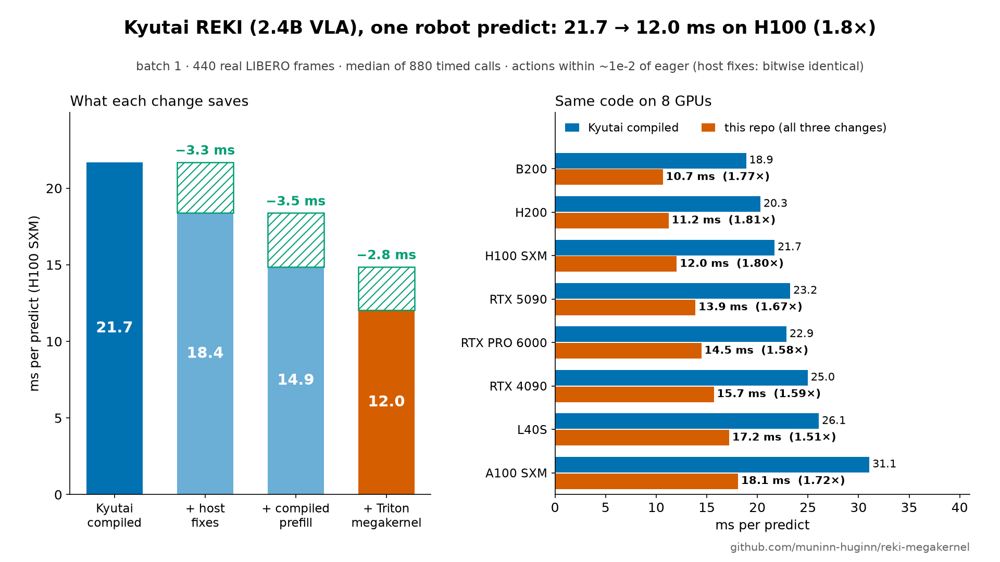
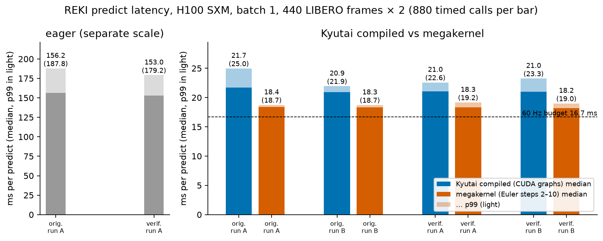
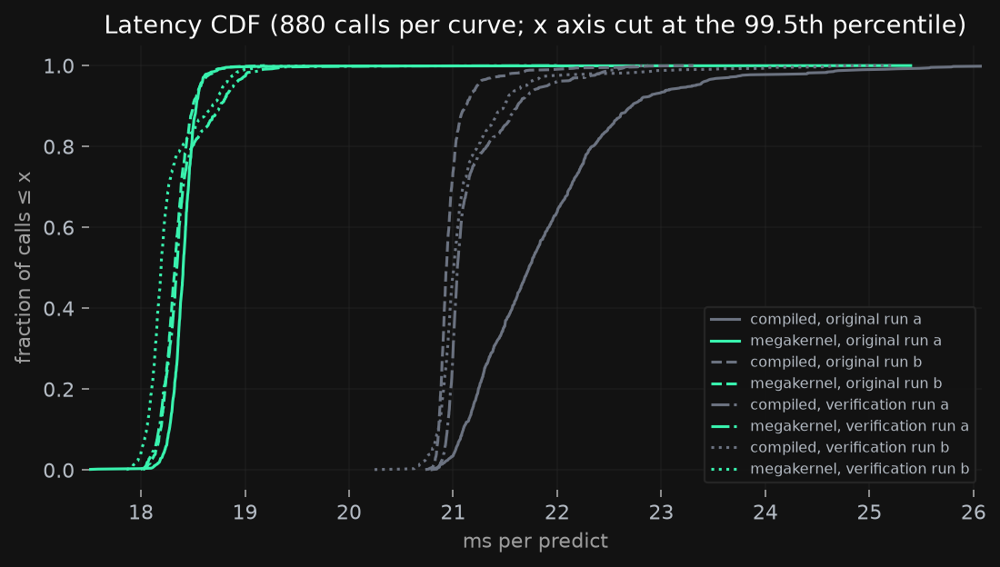
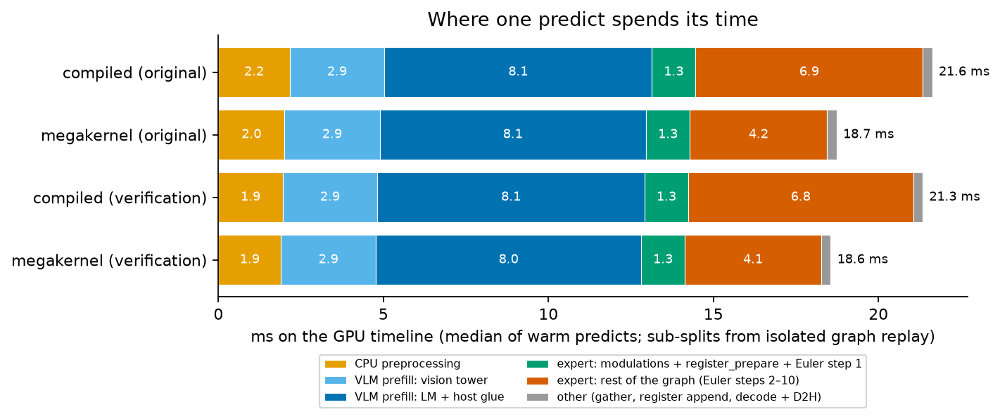
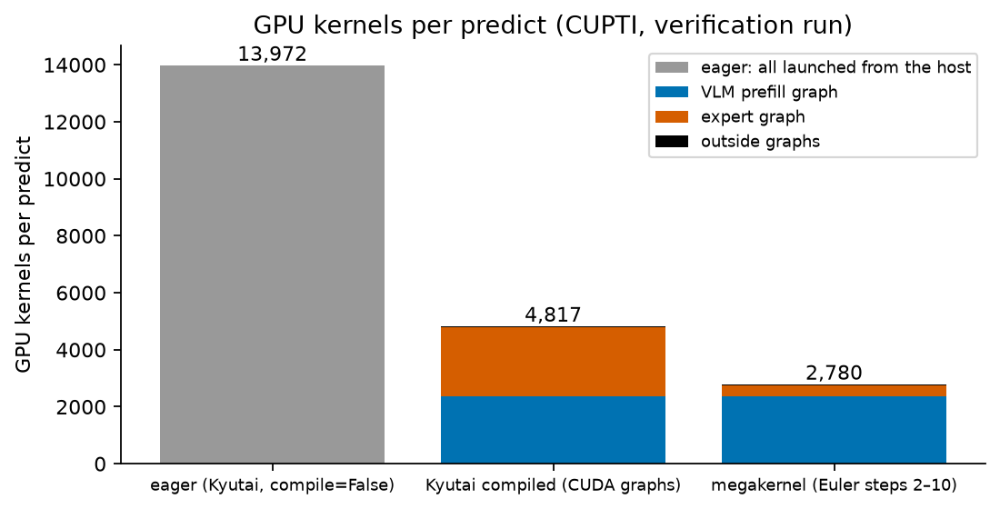
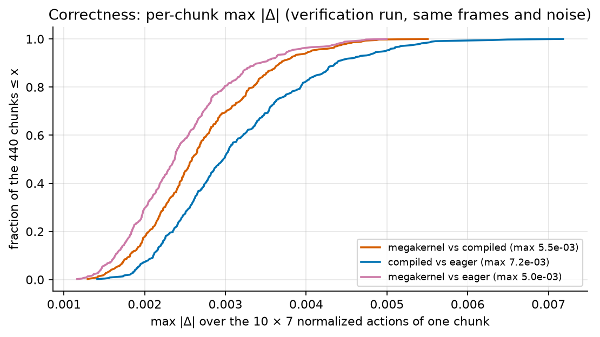
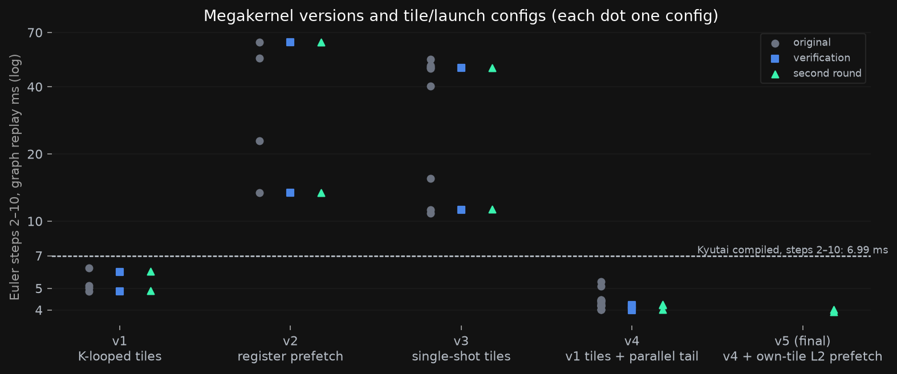
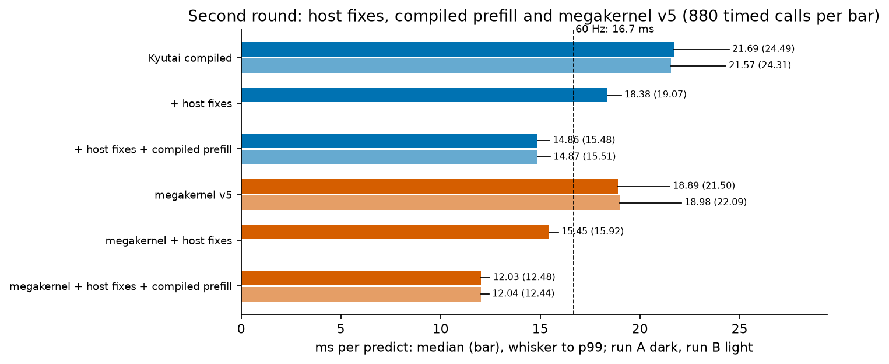
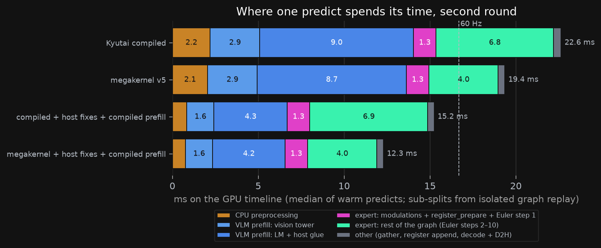
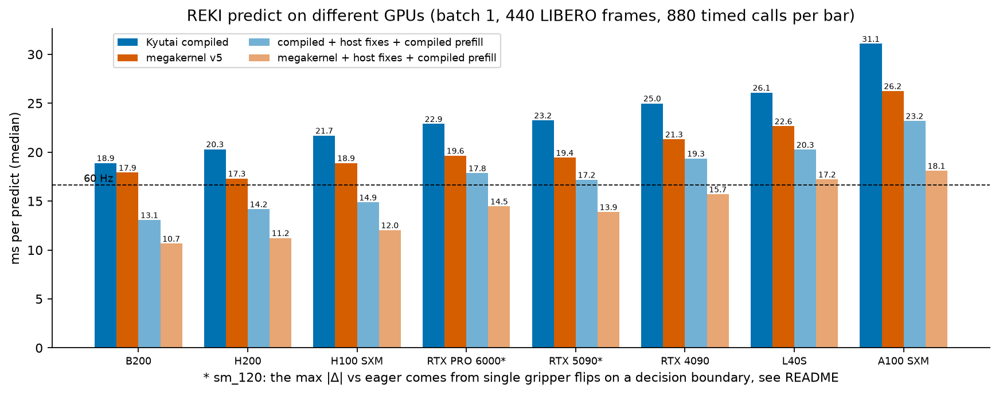

# A megakernel for an open VLA: Kyutai REKI, 21.7 → 12.0 ms per predict on one H100



- **12.0 ms per `predict`** on one H100 SXM (batch 1, 440 real LIBERO frames), down from 21.7 ms on
  Kyutai's compiled path: **1.8×**, p99 24.5 → 12.5 ms. In REKI's own loop (one `predict` per second)
  that is 1.2% instead of 2.2% of the cycle; where latency does matter is in [On a robot](#on-a-robot).
- **Megakernel:** Euler steps 2–10 of the 200M action expert run as one persistent Triton launch,
  6.9 → 3.9 ms (1.77×). On its own it makes `predict` 1.14–1.18× faster.
- **Host fixes:** −3.3 ms with bitwise-identical outputs. Kyutai's `predict` walks all 931 modules with
  `eval()` on every call and preprocesses images on the CPU.
- **Compiled prefill:** −3.5 ms (prefill graph 9.1 → 5.5 ms); actions within 1.1e-2 of eager, against
  6.9e-3 for Kyutai's own compiled path.
- **Eight GPUs:** 10.7 ms on B200, 11.2 ms on H200, 15.7 ms on RTX 4090, 18.1 ms on A100. The megakernel
  loop is 1.6–1.95× faster than Kyutai's on every one ([table](#other-gpus)).
- **Reproducible:** `make setup && make all`. Measured numbers are in [`results/`](results/) (JSON, logs);
  the few that are not are marked. The first round was re-run from a fresh clone on a second H100.

## What this is

The question: does a hand-written persistent ("mega") kernel speed up a real vision-language-action model
that is already captured in CUDA graphs? The model is [Kyutai REKI](https://kyutai.org/reki/)
([code](https://github.com/kyutai-labs/reki), weights
[`kyutai/reki-2b-libero`](https://huggingface.co/kyutai/reki-2b-libero)), 2.4B parameters: a Qwen3.5-2B
VLM prefills two 256×256 camera views and the instruction; a 200M flow-matching DiT action expert (10
layers, width 768, 12 heads, MLP 3072) cross-attends to the last VLM layer and integrates 10 Euler steps
into a chunk of 10 actions; 32 register tokens per frame are cached over 3 frames as memory. Kyutai's
inference path captures the prefill and the `torch.compile`d expert as CUDA graphs and reports 21.8 ms.

A megakernel runs many layers in one launch: co-resident thread blocks walk the layers and synchronize
through global memory. CUDA graphs remove the host cost of launches but not the GPU cost of each kernel
boundary (drain, launch, ramp-up, a trip to HBM). At batch 1 those boundaries dominate small layers; see
Hazy Research's [Llama-1B megakernel](https://hazyresearch.stanford.edu/blog/2025-05-27-no-bubbles) and
[Mirage MPK](https://github.com/mirage-project/mirage).

## Results on H100

Second round, [`results/opt/`](results/opt/); each change added on top of the previous one in the same
run; 880 timed calls per row; run B repeats the main rows.

| path | median ms (run A / B) | p99 ms | saved |
|---|---:|---:|---:|
| eager | 204.0 | 244.4 | |
| Kyutai compiled | 21.69 / 21.57 | 24.49 / 24.31 | |
| + host fixes | 18.38 | 19.07 | 3.31 |
| + compiled prefill | 14.86 / 14.87 | 15.48 / 15.51 | 3.52 |
| **+ megakernel v5** | **12.03 / 12.04** | **12.48 / 12.44** | 2.83 |
| megakernel v5 alone | 18.89 / 18.98 | 21.50 / 22.09 | |
| megakernel + host fixes | 15.45 | 15.92 | |

Eager is host-launch bound; it ran at 156 ms on the first-round machine.

**Correctness.** Same frames, same flow noise, register memory carried through each episode; max |Δ|
over the 7 action dims × 10 actions of the normalized chunk (values within ±1.03),
[`results/opt/run_a/correctness.json`](results/opt/run_a/correctness.json):

| pair (440 chunks) | max | mean | p99 of per-chunk max |
|---|---:|---:|---:|
| host fixes vs without (compiled and megakernel) | 0 | 0 | 0 |
| megakernel v5 vs compiled | 5.5e-3 | 7.6e-4 | 4.9e-3 |
| compiled vs eager | 6.9e-3 | 8.9e-4 | 5.8e-3 |
| compiled + host + compiled prefill vs eager | 1.1e-2 | 1.0e-3 | 8.0e-3 |
| megakernel + host + compiled prefill vs eager | 9.7e-3 | 8.9e-4 | 8.4e-3 |
| megakernel + host + compiled prefill vs compiled | 1.0e-2 | 9.3e-4 | 7.8e-3 |

The mean |Δ| stays between 7.6e-4 and 1.0e-3 for every compiled variant; the compiled prefill raises the
max from 6.9e-3 to about 1e-2.

**Where the time goes** (GPU timeline, median of warm predicts, `results/opt/breakdown_*.json`):

| stage | Kyutai compiled, ms | final path, ms |
|---|---:|---:|
| host preprocessing (GPU idle) | 2.20 | 0.76 |
| VLM prefill | 11.83 (graph 9.09, vision 2.88) | 5.79 (graph 5.52, vision 1.58) |
| CA-source gather + state conditioning | 0.05 | 0.05 |
| action expert | 8.15 | 5.35 (graph 5.22: 1.31 step 1 + modulations + `register_prepare`, 3.91 megakernel) |
| register append + decode + D2H | 0.39 | 0.33 |
| **total** | **22.66** | **12.31** |
| kernels per predict | 4,817 | 1,549 |

The largest items left are the LM part of the prefill (3.9 ms) and the megakernel (3.9 ms).

## What changed

### 1. Host fixes ([`src/fast_host.py`](src/fast_host.py))

Before the prefill graph starts, the GPU sat idle for 4.5–4.9 ms per predict. Measured on warm predicts:

- `RekiModel.predict_action_chunk` calls `self.eval()` every time, walking 931 modules: 1.5 ms. The fix
  calls it once and makes the per-call `eval()` a no-op.
- `FastQwenImageProcessor` normalizes and patchifies both images on the CPU in fp32 (0.65 ms), then 1.5 MB
  of pageable fp32 patches are copied to the GPU. `GpuImageProcessor` uploads the uint8 images (2 × 192 KB,
  pinned) and runs the same fp32 ops in the same order on the GPU. `bench.py --fast-host` checks that
  `pixel_values` match the CPU processor bitwise on every frame before timing. Images that need resizing
  fall back to Kyutai's CPU processor.
- `RekiPolicy.predict` wraps each camera array in a PIL image that the processor converts back (~0.3 ms).
  `fast_host.predict` is Kyutai's method (reki `b2a3393`) with the arrays passed through.

GPU idle time before the prefill drops to 1.0–1.2 ms, and the latency tail goes with it: p99 of the
megakernel path 21.5 → 15.9 ms.

### 2. Compiled prefill ([`src/fast_prefill.py`](src/fast_prefill.py))

Each ViT block (`dynamic=False`) and LM decoder layer (`dynamic=True`; prompt lengths differ per task) is
compiled with Inductor, without Inductor CUDA graphs, and captured in Kyutai's per-layout prefill graph,
the same way their compiled expert sits in theirs. `CompiledPrefillGraphs` checks the replay bitwise
against an uncaptured run of the same compiled forward. The first call after a compile differs from later
calls (max |Δ| 0.31 on the prefill output), so the third run is the reference. Prefill graph 9.09 → 5.49 ms
(vision tower 2.88 → 1.57 ms), 2,366 → 1,127 kernels. Not bitwise equal to eager: Inductor keeps fused
elementwise chains in fp32 where eager rounds each op to bf16.

### 3. The megakernel ([`src/mk_expert.py`](src/mk_expert.py))

**Target.** Kyutai's compiled Euler steps 2–10 are ≈2,047 kernels (cuBLAS GEMMs at M = 10 rows, flash
varlen attention, Inductor fusions) taking 6.9–7.0 ms. They move 212 MB of weights per step, an HBM floor
of 63 µs per step: the loop is launch- and latency-bound. Step 1 also processes the 32 register rows and
produces the register K/V, so it, the per-step modulations and `register_prepare` stay Kyutai's code.

**Design.** One launch of one program per SM (132 on H100) runs steps 2–10. Per step: 10 layers × 8 stages
(AdaRMS + QKV; self-attention per head over [cached registers ∥ own actions] with q/k RMSNorm + RoPE;
out-proj + gated residual; AdaRMS + cross-attention query; cross-attention per head over the cached VLM K/V
with online softmax; out-proj + gated residual; AdaRMS + gate/up + SiLU·mul; down + gated residual), then a
step tail on 72 programs (final AdaRMS, fp32 out-projection, Euler update, fp32 in-projection). A software
grid barrier on a monotonic atomic counter separates the stages: 730 per launch at ≈1.0 µs each, ≈0.73 ms
in total. Activations live in small L2-resident buffers read with `.cg` loads. Numerics follow Inductor:
bf16 GEMM inputs, fp32 accumulation, one bf16 rounding per Linear output and per fused elementwise op.
`install()` replaces REKI's `_expert_actions` with a version that runs their step 1 and then the
megakernel, inside REKI's own expert CUDA graph and its capture check.

Every stage is latency bound (a barrier plus one or two dependent L2/HBM round trips). Per-stage medians in
v4 (µs, barrier included): QKV 5.5, SA attention 4.7, SA out 3.2, CA query 5.2, CA attention 5.3, CA out
3.5, gate/up 7.5, down 7.4; 42 µs per layer plus a 21 µs step tail.

**v5** splits the barrier into arrive and wait. In between, each program prefetches into L2 the weight
tiles it owns in the next weight stage. v4's L2 prefetch lost because idle programs prefetched before
arriving and delayed the barrier; in v5 every program has already arrived. GEMM stages gain 0.3–0.9 µs
each, the attention stages lose 0.4–1.1 µs to the prefetch traffic, net 4.02 → 3.92 ms. Single-input check
against Kyutai's compiled steps 2–10 (`src/test_mk.py`): 2.3e-3.

**Versions** (steps 2–10, graph replay on the same expert inputs; Kyutai compiled 6.9–7.0 ms):

| version | idea | ms | source |
|---|---|---:|---|
| v1 | K-looped GEMM tiles (BK 128), one-program step tail | 5.89 (4.84 with BK 256, 8 warps) | 5.89: log not kept (5.92 in verification); 4.84: `results/original/logs/log_tune5.txt` |
| v2 | single-shot tiles, next stage's weights prefetched into registers before each barrier | 63.3 (13.4 with 4 warps) | `log_tune2.txt`; register spills |
| v3 | single-shot tiles, no large prefetch | 48.6 (10.8 with `maxnreg=255`, 4 warps) | `log_tune3/4.txt`; 1.2–2.1 KB spills |
| v4 | v1 tiles, one-round-trip RMS pass, parallel step tail, 4 warps | 4.01 | `log_tune6–8.txt` |
| v4 + L2 prefetch | idle programs prefetch the next stages' weights | 4.17–4.18 | `log_tune7/8.txt` |
| v4, 2 programs per SM | more tiles in flight | 4.17–4.45 | `log_tune9.txt` |
| **v5** | v4 + own-tile L2 prefetch between barrier arrive and wait | **3.92** (4.02 without) | `results/opt/tune/v5.json` |

Tried for v5 and dropped (development runs, logs not kept): prefetch that skips the attention stages 3.93
ms; barrier polling with `ld.acquire.gpu` 3.95–3.98 ms (1.19 µs per barrier vs 1.02 µs); weights
`evict_first` + K/V `evict_last` 3.89 ms (within noise); CA attention blocks of 32 / 128 / 256 rows 3.99 /
4.03 / 4.38 ms (64: 3.92 ms); CA query fused into CA attention (one barrier less per layer, 12 programs
loading 96 KB each) 4.29 ms; step tail as fp32 `ieee` dots 4.05 ms.

[Mirage MPK](https://github.com/mirage-project/mirage) (branch `mpk` @ `ca58a02`) was evaluated and not
used: its task library targets LLM decode and has none of the blocks the expert needs (AdaRMS modulation,
gated residuals, attention over cached register K/V and an external VLM source with MRoPE, fp32 action
projections), nor a ViT or Gated-DeltaNet layer.

## Other GPUs

Same code on seven more GPU types, one cloud machine each (`make -k gpu OUT=results/gpus/<gpu>`, driver
595.91; [`results/gpus/`](results/gpus/)). The megakernel runs one program per SM with the H100 tile
configs, unchanged. Median ms over 880 timed calls; the H100 row is the second round's run A. The steps 2–10
column comes from `src/test_mk.py` on every GPU (on H100 it gives 6.73 ms for Kyutai's loop where the
breakdown gives 6.92 ms).

| GPU | Kyutai compiled | megakernel | compiled + host fixes + compiled prefill | megakernel + host fixes + compiled prefill | total speed-up | steps 2–10: megakernel / Kyutai | max \|Δ\| final path vs eager |
|---|---:|---:|---:|---:|---:|---:|---:|
| B200 | 18.89 | 17.91 | 13.06 | 10.65 | 1.77× | 4.00 / 6.44 ms | 1.1e-2 |
| H200 | 20.30 | 17.31 | 14.17 | 11.23 | 1.81× | 3.87 / 6.91 ms | 9.0e-3 |
| H100 SXM | 21.69 | 18.89 | 14.86 | 12.03 | 1.80× | 3.91 / 6.73 ms | 9.7e-3 |
| RTX PRO 6000 Blackwell | 22.88 | 19.64 | 17.85 | 14.46 | 1.58× | 3.95 / 7.50 ms | 1.9* |
| RTX 5090 | 23.25 | 19.43 | 17.17 | 13.88 | 1.68× | 3.49 / 6.78 ms | 1.7* |
| RTX 4090 | 24.98 | 21.31 | 19.35 | 15.70 | 1.59× | 3.90 / 7.62 ms | 1.1e-2 |
| L40S | 26.08 | 22.65 | 20.25 | 17.22 | 1.51× | 4.54 / 8.12 ms | 1.4e-2 |
| A100 SXM 80GB | 31.07 | 26.25 | 23.19 | 18.10 | 1.72× | 5.81 / 10.81 ms | 9.5e-3 |

- The megakernel speeds up Euler steps 2–10 1.6–1.95× on every GPU and `predict` 1.05–1.20× on its own.
  The final path stays under 16.7 ms on six of the eight.
- \* RTX 5090 and RTX PRO 6000 (sm_120). Kyutai's own compiled path is also 0.08–0.24 from eager there,
  against 6–7e-3 on the other GPUs. In an 86-frame rerun on an RTX 5090, 85 frames agree within 1e-2. The remaining
  frame is a gripper toggle on a decision boundary: action 8 is 0.94 (compiled), 0.70 (eager) and −1.00
  (final path), while the six arm dims differ by at most 0.067. The single-input expert check agrees within
  2e-3 on sm_120, and the per-layer prefill outputs of an RTX 5090 differ from an RTX 4090 about as much as
  eager and compiled differ on one GPU (2.6e-2 vs 2.4e-2 relative at the VLM output). No faulty kernel
  found; the RTX PRO 6000 was not rerun ([`divergence_check.txt`](results/gpus/rtx5090/divergence_check.txt)).

## On a robot

REKI predicts a 1 s chunk (10 actions at 10 Hz on LIBERO), the robot executes it open loop, and `predict`
runs once per second; the register memory is trained on that 1 s frame spacing, and Kyutai's `RekiPolicy`
warns that another cadence changes it unnoticed. In that loop the speed-up is small:

| | Kyutai compiled | final path |
|---|---:|---:|
| `predict` median / p99 | 21.7 / 24.5 ms | 12.0 / 12.5 ms |
| share of the 1 s cycle | 2.2% | 1.2% |
| age of the frame behind the first action | +21.7 ms | +12.0 ms |
| action period | 100 ms | 100 ms |

It matters when:

- **Inference overlaps execution** (the next chunk is computed while the current one runs): the latency sets
  how many old actions run before the new chunk lands. At 10 Hz both paths fit in one action step; on a
  50 Hz controller (20 ms steps) 21.7 ms costs two steps and 12.0 ms one.
- **The robot replans more often** than once a second. Latency then counts directly, but REKI's memory
  would need its own 1 s cadence; untested here.
- **Timing must be predictable:** the p99 halves (24.5 → 12.5 ms), and the host fixes remove most of the
  run-to-run tail.
- **The GPU is shared** with perception or other models, is slower than an H100 (A100: 31.1 → 18.1 ms), or
  serves several robots.

Not included in the numbers: camera exposure and transfer, any network hop, actuation. The benchmark times
`predict` alone on recorded frames; nothing here measures task success in closed loop.

## First round and verification

The first round used megakernel v4 with Kyutai's host path and prefill
([`results/original/`](results/original/)). A fresh H100 machine then cloned the repository and ran only
`make setup`, `make all` and `make figures` ([`results/verification/`](results/verification/)).

| | original (run A / B) | verification (run A / B) |
|---|---:|---:|
| eager median (p99), ms | 156.2 (187.8) | 153.0 (179.2) |
| compiled median (p99), ms | 21.73 (24.98) / 20.94 (21.95) | 21.04 (22.58) / 21.01 (23.25) |
| megakernel v4 median (p99), ms | 18.41 (18.74) / 18.33 (18.72) | 18.35 (19.16) / 18.19 (18.99) |
| speed-up, same run | 1.18× / 1.14× | 1.15× / 1.15× |
| max \|Δ\| megakernel vs compiled / compiled vs eager / megakernel vs eager | 5.5e-3 / 6.9e-3 / 5.8e-3 | 5.5e-3 / 7.2e-3 / 5.0e-3 |
| kernels per predict: eager / compiled / megakernel | 13,972 / 4,837 / 2,791 | 13,972 / 4,817 / 2,780 |
| Euler steps 2–10, graph replay: compiled / megakernel, ms | 6.99 / 4.03 | 6.96 / 4.01 |
| whole expert graph: compiled / megakernel, ms | 8.26 / 5.36 | 8.25 / 5.33 |
| single-input check: megakernel vs compiled / compiled vs eager | 2.3e-3 / not saved | 1.9e-3 / 1.8e-3 |
| grid barrier, µs | 1.0 | 1.02 |

Medians reproduce within the run-to-run spread. The verification megakernel p99 was 0.3–0.4 ms higher, still
below every compiled p99. Inductor generated 20 fewer kernels in the compiled expert graph on the fresh
compile, with unchanged replay time. The version ladder reproduced too (`results/verification/tune/`).

## Setup

| | |
|---|---|
| GPU | NVIDIA H100 80GB HBM3 (SXM), driver 595.91, cloud container |
| software | Python 3.12, torch 2.10.0+cu128, triton 3.6.0, transformers 5.3.0, flash-linear-attention 0.4.2 (Kyutai's `pixi.lock`), REKI at `b2a3393` |
| measured call | `RekiPolicy.predict`: uint8 images + raw state + task text in, unnormalized action chunk on the host out; batch 1 |
| inputs | `HuggingFaceVLA/libero` chunk 000, files 000/060/120/180/240/300/360: 24 episodes, 19 tasks, every 10th frame (the model's 1 s history stride), 440 frames; register memory carried within and reset between episodes |
| noise | call *i* draws its flow noise from a CUDA generator seeded 1234 + *i*: every path sees the same noise per frame |
| timing | one untimed pass over the 440 frames (captures graphs, saves chunks for the \|Δ\| tables), then 880 timed calls per path, host wall clock around each `predict` |

`torch` uses 8 threads (`REKI_THREADS`). The container's CPU quota (17–22 CPUs) is far below the core count
torch sees, and with the default thread count CPU preprocessing was throttled on every other call.

## Limitations

- Batch 1, one checkpoint (LIBERO finetune), one cloud machine per GPU type and run.
- No closed-loop evaluation: correctness is |Δ| of action chunks against Kyutai's paths, not task success.
- Kyutai's compiled path varies by up to 0.8 ms between runs; compare speed-ups within a run.
- The megakernel is specialized to this expert (≤ 16 action rows, width 768, 12 heads, batch 1) and needs
  every program resident at once; otherwise the software grid barrier deadlocks.
- Step 1, the modulations and `register_prepare` remain Kyutai's compiled code.
- The compiled prefill is not bitwise equal to Kyutai's and uses their private `_LayoutGraph`. The host
  fixes copy Kyutai's `predict` and image preprocessing at `b2a3393` and must track upstream changes.
- All steps run in one launch, so nothing can run between steps. Per-step guidance such as real-time
  chunking would need a launch per step or the guidance inside the kernel. REKI has no such hook.
- The GPU image path only takes images already at REKI's input size (LIBERO's 256×256). A camera at another
  resolution goes through Kyutai's CPU resize and normalization; that cost is not measured here.
- The first `predict` of each new prompt compiles and captures graphs: the untimed first pass has a p99 of
  280 ms on Kyutai's path and 574 ms on the final path. Run every task prompt once before the control loop.

## What's left

- **Expert loop** (3.9 ms; ~1.5–2 ms estimated from the stage profile): stream weights into shared memory with
  TMA one or two stages ahead, dataflow counters instead of grid-wide barriers, split-head attention. That
  means CUDA C++; v5's L2 prefetch is the part Triton can express.
- **Step 1, modulations and `register_prepare`** (1.31 ms): register rows with plain norms, segmented varlen
  attention over the register buffer, the register K/V output, and the cross-attention K/V projections of
  the VLM source (31 M weights).
- **VLM prefill** (5.5 ms compiled): a ViT, 18 Gated-DeltaNet layers (FLA Triton kernels) and 6 attention
  layers with MRoPE at 180–260 tokens. Floor ≈ 1–2 ms (~3 GB of weights at 3.35 TB/s plus 0.5–0.8 TFLOP);
  no megakernel framework has these blocks.
- **Host preprocessing** (0.76 ms: state normalization, token-cache lookup, small copies): overlap it with
  the previous chunk or build the inputs on the GPU.

## Reproduce

On a machine with one NVIDIA GPU (driver ≥ 570), git, make and [uv](https://docs.astral.sh/uv/):

```bash
git clone https://github.com/muninn-huginn/reki-megakernel && cd reki-megakernel
make setup                          # .venv, REKI @ b2a3393, pinned torch/triton/transformers/fla, weights + LIBERO frames
source .venv/bin/activate
make all OUT=results/mine           # every path of both rounds, |Δ|, kernel counts, breakdowns, checks, ladder v1-v5 (~30-40 min on H100)
make -k gpu OUT=results/gpus/mine   # shorter set used for the other GPUs (~25 min)
make figures                        # figures/*.png|svg and results/csv/*.csv
```

The `mk` path is v5; the first-round numbers used v4 (`archive/mk_expert_v4.py`). Individual targets:
`latency`, `correctness`, `kernels`, `breakdown`, `check`, `tune`. Inputs go to `data/` (override with
`REKI_CKPT`, `REKI_DATA`).

## Layout

```
src/mk_expert.py          the megakernel (v5) + install() into a REKI model
src/fast_host.py          host fixes for RekiPolicy.predict (no per-call eval(), GPU image preprocessing)
src/fast_prefill.py       torch.compile of the vision blocks and LM layers inside the prefill CUDA graph
src/harness.py            frames, fixed noise, timing, chunk capture, load_path (path + options -> policy)
src/bench.py              latency + chunks of one path (eager | compiled | mk, [--fast-host] [--compile-prefill])
src/compare.py            max |Δ| between paths
src/count_kernels.py      kernels inside the prefill / expert graphs
src/profile_breakdown.py  stage split, isolated graph replays, kernels per predict
src/test_mk.py            single-input check of the megakernel against eager / compiled steps 2–10
src/tune_mk.py            barrier cost, per-stage timeline, tile configs, any kernel version
archive/mk_expert_v1-4.py superseded kernel versions, kept for the ladder
results/original/         first round (v4): latency, breakdowns, kernel counts, correctness, tuning logs
results/verification/     first round re-run from a fresh clone
results/opt/              second round: every path and option, breakdowns, kernel counts, correctness, ladder v1-v5
results/gpus/             main paths, |Δ|, single-input check and breakdown on seven more GPU types
results/csv/              tidy CSVs behind each figure
figures/                  make_figures.py, figures a-i and hero (PNG + SVG)
scripts/setup.sh          environment and inputs
```

## Figures

Built by [`figures/make_figures.py`](figures/make_figures.py) from the result JSONs; the CSV behind each is
in [`results/csv/`](results/csv/).

| | |
|---|---|
| (a) first round: median + p99 latency, original and verification ([csv](results/csv/latency_summary.csv)) |  |
| (b) first round: latency CDF ([csv](results/csv/latency_calls.csv)) |  |
| (c) first round: time breakdown of one predict ([csv](results/csv/breakdown.csv)) |  |
| (d) first round: GPU kernels per predict ([csv](results/csv/kernels.csv)) |  |
| (e) first round: per-chunk max \|Δ\| ([csv](results/csv/correctness_per_chunk.csv)) |  |
| (f) megakernel versions and configs, Euler steps 2–10 ([csv](results/csv/tuning.csv)) |  |
| (g) latency of each change ([csv](results/csv/ladder_latency.csv)) |  |
| (h) time breakdown of one predict, second round ([csv](results/csv/breakdown_opt.csv)) |  |
| (i) the four main paths on eight GPUs ([csv](results/csv/gpus_latency.csv)) |  |
| hero: the three changes on H100 and both ends on eight GPUs (from the same JSON as g and i) |  |

In (c) and (h), "rest of the graph" is the expert stage minus the isolated replay of step 1, modulations
and `register_prepare`: Euler steps 2–10 plus graph overhead.

## Credits

- [Kyutai](https://kyutai.org/reki/) for REKI (code MIT, weights CC-BY-NC-SA 4.0). The megakernel
  re-implements their action expert and the scripts drive their inference API; see [NOTICE](NOTICE).
- Hazy Research / [ThunderKittens](https://github.com/HazyResearch/ThunderKittens) for the megakernel idea
  and vocabulary (no code used).
- LIBERO frames from [`HuggingFaceVLA/libero`](https://huggingface.co/datasets/HuggingFaceVLA/libero).

## License

MIT ([LICENSE](LICENSE)); third-party notices in [NOTICE](NOTICE).
